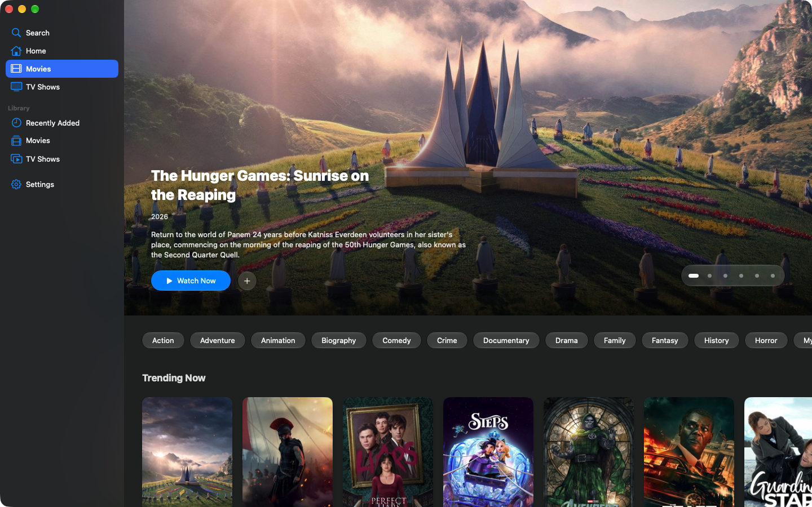
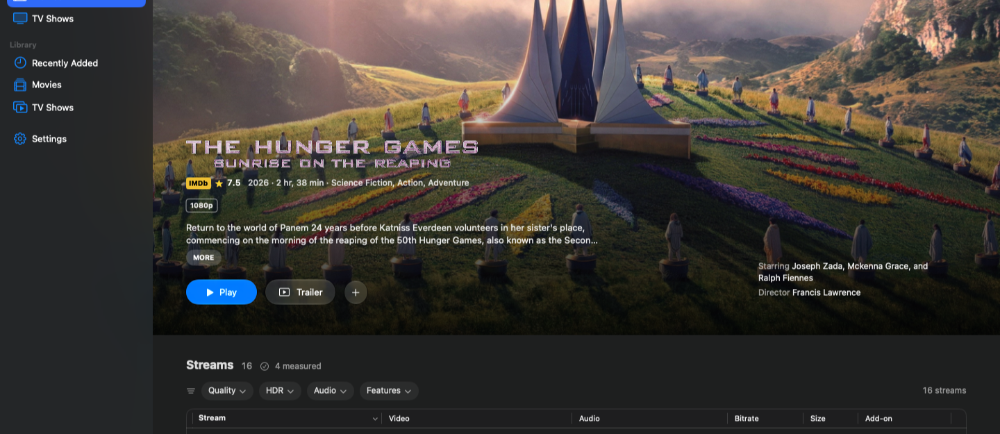
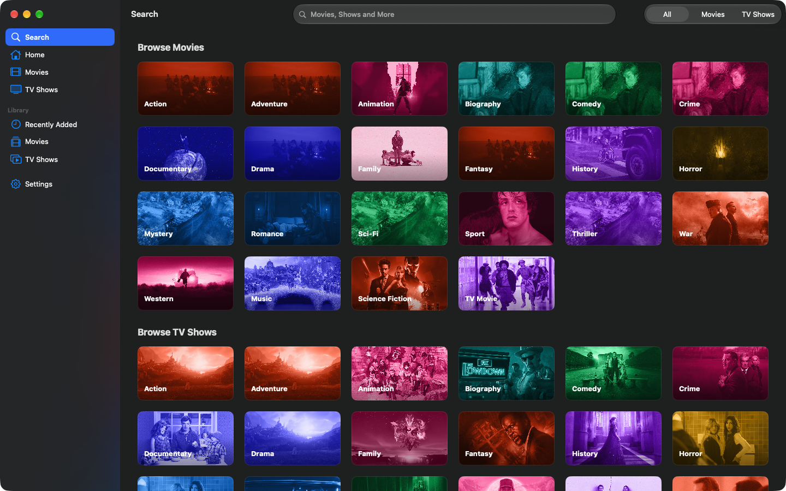

# Foyer

[](https://github.com/iamsj7/Foyer-macOS/releases/latest)
[](https://github.com/iamsj7/Foyer-macOS/actions/workflows/release.yml)
[](https://github.com/iamsj7/Foyer-macOS/releases)


[](LICENSE)

A native macOS media center for Stremio-compatible add-ons, built with SwiftUI and designed after
Apple's TV app, with Liquid Glass on macOS 26 and later.

Browse catalogs, open rich title pages, and play streams in Apple's player (HDR, Dolby Vision, Spatial
Audio, AirPlay, Picture in Picture), with **mpv** as a fallback for MKV and other formats.

> **Foyer doesn't host, provide or link to any content.** Everything you see comes from add-ons
> you choose to install. The app suggests only legal add-ons (catalogs, metadata, subtitles, trailers)
> and never suggests stream sources. You're responsible for the add-ons you add and how you use them.



| Title page | Browse Categories |
|---|---|
|  |  |

## Features

- **TV-app-style browsing:** featured hero, Trending Now, catalog shelves, genre chips and pages,
  Browse Categories in Search, Continue Watching, and a Library.
- **Title pages:** artwork, logo, ratings, cast with photos (when an add-on provides them), episodes,
  trailers, and a full stream table.
- **Stream table built for quality:** resolution, HDR / Dolby Vision, audio format and channels,
  bitrate and size, with *Best quality*, *Best video* and *Best audio* markers. Specs are measured
  from HLS playlists and media tracks, not just labels.
- **Smart Play:** checks sources in quality order and starts the best one that actually responds.
  **Resume** continues on the same source.
- **Two players, one control bar:**
  - Apple's player (AVFoundation) for MP4 and HLS: HDR, Dolby Vision, Atmos, AirPlay, PiP.
  - mpv (via [MPVKit](https://github.com/mpvkit/MPVKit)) for MKV, AVI, WebM and more.
  - It switches to mpv automatically when Apple's player can play the audio but not the video.
  - Picture modes: Fit, Fill, Stretch, Actual Size, plus cinema and IMAX aspect presets in mpv.
- **Subtitles** from subtitle add-ons, with language preference and timing adjustment.
- **Native Mac app:** menu commands and shortcuts, keyboard-driven player, Reduce Motion support,
  VoiceOver labels.

## Requirements

- Apple silicon Mac
- macOS 14 Sonoma or later (Liquid Glass needs macOS 26)
- To build: Xcode 26 or later (Swift 6 toolchain)

## Install

Download the latest `Foyer-<version>-macOS-arm64.zip` from
[Releases](https://github.com/iamsj7/Foyer-macOS/releases), unzip it, and move **Foyer.app** to Applications.

Release builds are ad-hoc signed. On first launch, right-click the app and choose **Open**, or
allow it in **System Settings ▸ Privacy & Security**.

## Build from source

```bash
git clone https://github.com/iamsj7/Foyer-macOS.git
cd Foyer-macOS
scripts/run.sh                # build (release, arm64) and launch
```

Or open `Package.swift` in Xcode, pick the **Foyer** scheme, and press ⌘R.

Package a release build:

```bash
scripts/package-app.sh        # dist/Foyer.app and a zip for GitHub Releases
```

Run the end-to-end checks against a stream add-on of your own:

```bash
scripts/check.sh "<manifest URL>"                 # all groups
scripts/check.sh "<manifest URL>" --only catalog  # setup, catalog, streams, quality, playback,
                                                  # mpv, subtitles, persistence
```

## Add-ons

On first launch, Foyer installs three legal add-ons that need no account:

| Add-on | Provides |
|---|---|
| Cinemeta | Movie and TV catalogs, title details, IMDb ratings |
| The Movie Database | Trending, genres, details, cast photos |
| OpenSubtitles v3 | Subtitles |

More legal suggestions are in **Settings ▸ Add-ons**. Any Stremio-compatible add-on can be added by
pasting its manifest URL. See the [wiki](https://github.com/iamsj7/Foyer-macOS/wiki/Add-ons) for details.

## Project layout

```
Sources/
  AddonKit/       Stremio protocol client, models, stream quality, HLS tools, subtitles
  Foyer/   The SwiftUI app (browsing, title pages, players, settings)
  checks/         End-to-end checks executable
scripts/          run, check, and release packaging
docs/wiki/        Wiki pages (mirrored to the GitHub wiki)
```

## Privacy

Foyer has no accounts, analytics or telemetry. It checks GitHub Releases for updates once a day (an
anonymous request; turn it off in Settings ▸ About). Add-ons, library and watch progress are stored
locally in `~/Library/Application Support/Foyer/`. Add-on manifest URLs can contain private
tokens: the app never logs them, and stream lists and playlists are kept out of the disk cache.

## Contributing

Issues and pull requests are welcome. Read [CONTRIBUTING.md](CONTRIBUTING.md) first.

## License

Foyer is free software, licensed under the
[GNU General Public License v3.0 or later](LICENSE).

It bundles open-source components under their own licenses, including mpv, FFmpeg and libplacebo
(LGPL) through MPVKit. See [THIRD_PARTY_NOTICES.md](THIRD_PARTY_NOTICES.md).

This product uses the TMDB API but is not endorsed or certified by TMDB. Foyer is not affiliated
with Apple, Stremio, IMDb, TMDB or OpenSubtitles.
